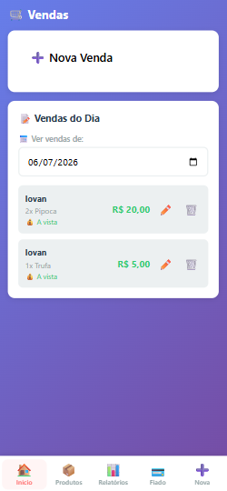
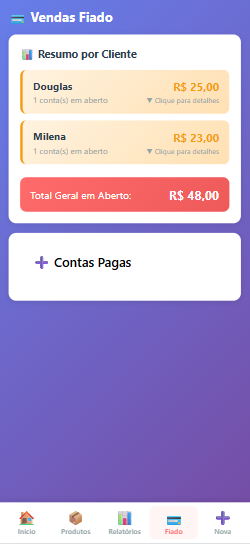

# 🍬 Vendas ConfeitAna — Controle de Vendas e Pagamentos

Aplicação web para controle de vendas de doces, desenvolvida com Python, Flask, SQLAlchemy e SQLite.

O sistema reúne cadastro de produtos, registro de vendas, controle de valores a receber e relatórios, com interface responsiva para utilização pelo celular.

## Contexto e objetivo

Desenvolvi este sistema para organizar minhas vendas de trufas no trabalho.

A aplicação permite registrar os produtos vendidos, identificar o cliente, acompanhar vendas realizadas a prazo e marcar os pagamentos recebidos. Os relatórios ajudam a consultar o movimento diário, mensal, anual ou de um período específico.

O projeto surgiu de uma necessidade prática: manter as informações de vendas e pagamentos organizadas em um único lugar.

## Situação do projeto

**Em uso e em evolução.**

O sistema é utilizado nas minhas vendas e recebe melhorias conforme as necessidades identificadas no dia a dia.

## Principais funcionalidades

- Cadastro de produtos com nome, preço e categoria.
- Busca de produtos cadastrados.
- Registro de vendas com cliente e data.
- Inclusão de produtos e quantidades na venda.
- Cálculo do valor total da venda.
- Identificação de vendas à vista ou fiado.
- Consulta de vendas por data.
- Edição e exclusão de vendas.
- Controle de valores em aberto por cliente.
- Registro de pagamentos recebidos.
- Consulta de contas pagas.
- Resumo de vendas do dia.
- Relatório mensal.
- Relatório por período.
- Resumo do ano.
- Identificação dos maiores compradores nos relatórios.
- Acesso administrativo com login.
- Interface responsiva com navegação pelo celular.

## 📸 Demonstração do sistema

### Acompanhamento das vendas

Tela para consultar as vendas de uma data, identificando cliente, produtos, quantidades, valores e modalidade de pagamento.



### Registro de uma nova venda

Formulário para informar cliente e data, selecionar produtos e quantidades e indicar se a venda ficará fiado.

O total é apresentado antes da confirmação.


### Cadastro de produtos

Cadastro de produtos com nome, preço e categoria, acompanhado de busca e listagem dos itens.


### Controle de valores a receber

Organização das contas em aberto por cliente, com total pendente e separação das contas pagas.

O registro dos pagamentos permite acompanhar quem ainda possui valores a quitar.



### Resumo diário e relatório mensal

Consulta de totais e quantidade de vendas, com identificação dos maiores compradores no intervalo selecionado.


### Relatório por período e resumo anual

Consulta das vendas entre duas datas e acompanhamento do total de vendas de um ano.


## Fluxo de utilização

1. Cadastrar os produtos, preços e categorias.
2. Registrar uma venda com cliente, data, produtos e quantidades.
3. Informar se a venda foi à vista ou ficará fiado.
4. Confirmar a venda e consultar o registro na listagem.
5. Acompanhar os valores em aberto na tela de fiado.
6. Registrar o pagamento quando o cliente quitar a conta.
7. Consultar os relatórios para acompanhar as vendas.

## Controle de pagamentos

O sistema diferencia o registro da venda do acompanhamento dos valores a receber.

| Situação | Funcionamento |
|---|---|
| Venda à vista | Registro identificado como venda à vista. |
| Venda fiado | Valor incluído no controle de contas em aberto. |
| Pagamento recebido | Registro do pagamento para atualização da pendência. |
| Conta paga | Consulta na seção de contas pagas. |

Os valores em aberto são agrupados por cliente para facilitar o acompanhamento.

## Relatórios disponíveis

| Relatório | Finalidade |
|---|---|
| Resumo do dia | Consultar as vendas de uma data específica. |
| Relatório mensal | Acompanhar as vendas de um mês e ano selecionados. |
| Relatório por período | Consultar o movimento entre uma data inicial e uma data final. |
| Resumo do ano | Acompanhar as vendas do ano selecionado. |

Os relatórios apresentam totais, quantidade de vendas e informações sobre os maiores compradores.

## Tecnologias

| Camada | Tecnologias |
|---|---|
| Backend | Python e Flask |
| Persistência | SQLAlchemy e Flask-SQLAlchemy |
| Banco de dados | SQLite |
| Interface | HTML, CSS e JavaScript |
| Comunicação com o backend | Rotas HTTP com respostas JSON |
| Versionamento | Git e GitHub |

## Organização do código

A aplicação concentra as rotas e os modelos no arquivo `app.py`, com separação dos templates e arquivos estáticos.

```text
app.py
requirements.txt

templates/
├── base.html
├── login.html
├── vendas.html
├── produtos.html
├── relatorios.html
└── fiado.html

static/
├── css/
│   └── style.css
├── js/
│   └── app.js
├── icons/
├── manifest.json
└── service-worker.js
```

- **app.py:** configuração, modelos, rotas e operações da aplicação.
- **templates:** páginas da interface.
- **static/css:** estilos e adaptação da interface aos tamanhos de tela.
- **static/js:** interações da interface.
- **requirements.txt:** dependências Python.

## Aspectos técnicos do projeto

- Modelagem de produtos, vendas e contas a receber.
- Persistência dos registros em banco SQLite.
- Rotas para cadastro, consulta, alteração e exclusão de informações.
- Consulta de vendas com filtros de data.
- Agrupamento de valores em aberto por cliente.
- Geração de relatórios para diferentes intervalos.
- Interface voltada ao uso cotidiano pelo celular.
- Formatação de valores monetários para o padrão brasileiro.

## Execução local

### 1. Clonar o repositório

```bash
git clone https://github.com/LovanGoulart/vendas-confeitana.git
cd vendas-confeitana
```

### 2. Criar um ambiente virtual

```bash
python -m venv .venv
```

### 3. Ativar o ambiente virtual

**Windows — Git Bash:**

```bash
source .venv/Scripts/activate
```

**Windows — Prompt de Comando:**

```bat
.venv\Scripts\activate.bat
```

**Linux ou macOS:**

```bash
source .venv/bin/activate
```

### 4. Instalar as dependências

```bash
python -m pip install -r requirements.txt
```

### 5. Iniciar a aplicação

```bash
python app.py
```

### 6. Acessar no navegador

```text
http://localhost:5000
```

A aplicação utiliza SQLite, sem necessidade de instalar um servidor de banco separado.

O comando acima inicia o servidor de desenvolvimento. A publicação em produção exige configuração própria de hospedagem e credenciais de acesso.

## Autor

Desenvolvido por **Lovan Goulart** a partir de uma necessidade real de organização das vendas de trufas no trabalho.

[Perfil no GitHub](https://github.com/LovanGoulart)
